# 🔐 Week 3 — Password Cracking (JTR & Networkwalks Tools)

Week 3 internship project — **Network Walks Academy**. This module covers password cracking against intentionally password-protected training PDFs, using two different approaches: **John the Ripper (JTR)** via the Johnny GUI, and **Networkwalks' own web-based cracking tools**.

> These are training/lab files created by Network Walks specifically for this exercise — not third-party protected documents. The goal was to learn the dictionary-attack workflow: extract a crackable hash from a protected file, run it against a wordlist, and recover the password.

---

## 📦 Target Files

| File | Password Recovered | Flag Captured |
|---|---|---|
| `My Locked PDF1.pdf` | `good-luck` | — |
| `My Locked PDF2.pdf` | `password1` | `nw{networkwalks_persistence_jtr_270521}` |
| `My Locked PDF3.pdf` | `1qaz2wsx` | `nw{networkwalks_flag_260821_1}` |

---

## 1️⃣ Password Cracking with John the Ripper (via Johnny GUI)

### Tools used
- [John the Ripper](https://www.openwall.com/john/) (JTR) — the actual cracking engine
- [Johnny](https://openwall.info/wiki/john/johnny) — GUI front-end for John the Ripper
- [Online HashCrack's PDF Hash Extractor](https://www.onlinehashcrack.com/tools-pdf-hash-extractor.php) — to pull the crackable hash out of the PDF

### Step 1 — Configure Johnny to use John the Ripper

Johnny needs to be pointed at the actual `john.exe` executable (downloaded separately from John the Ripper's official site, not bundled with Johnny itself) before it can run any attack.

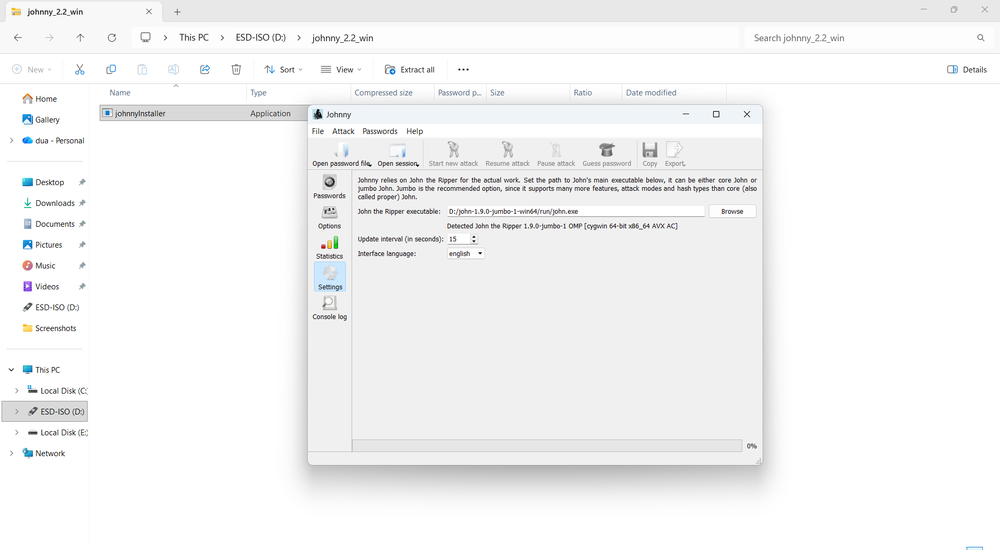

### Step 2 — Extract the hash from the PDF

Using the PDF Hash Extractor (which runs `pdf2john` under the hood), uploaded `My Locked PDF1.pdf` and received a crackable `$pdf$...` hash, which was saved locally as `HASH1.txt`.

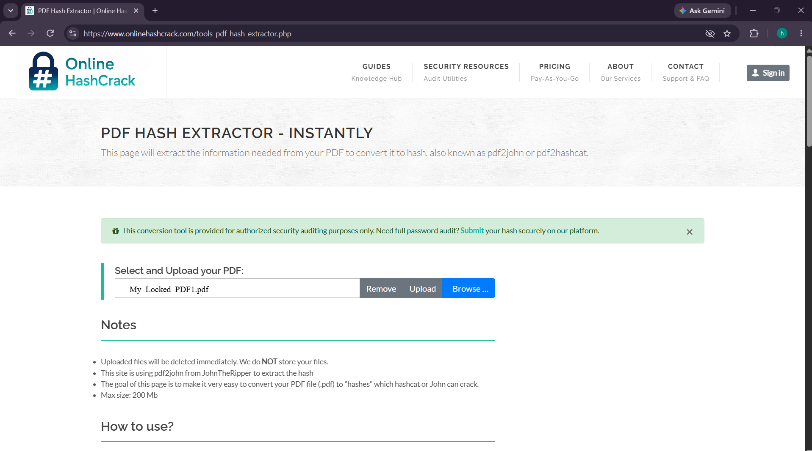
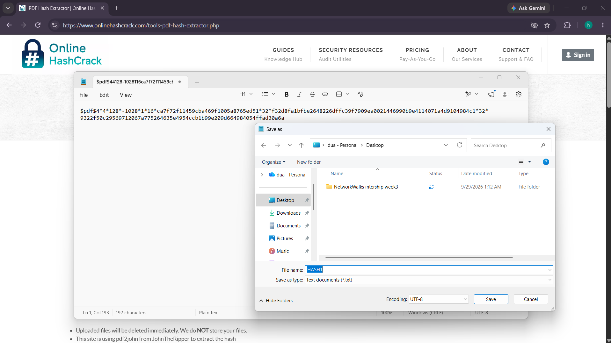

### Step 3 — Load the hash into Johnny and run the attack

Loaded `HASH1.txt` into Johnny and started the attack. It completed instantly (100%, 1/1 cracked) and recovered the password: **`good-luck`**.

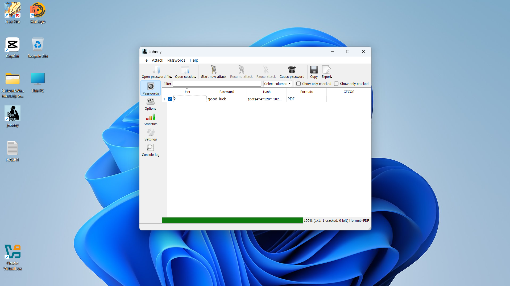

### Step 4 — Confirm the password unlocks the PDF

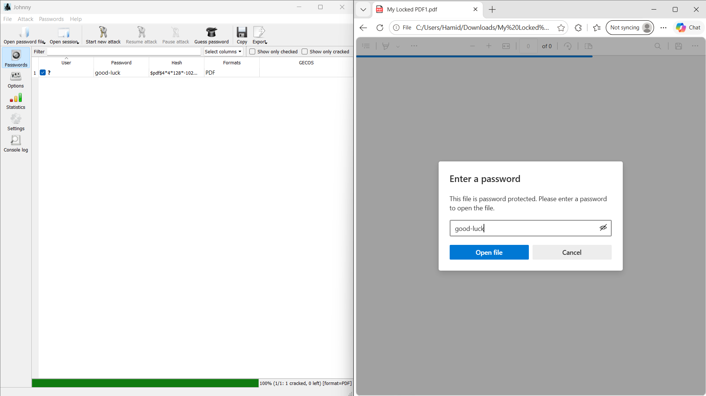
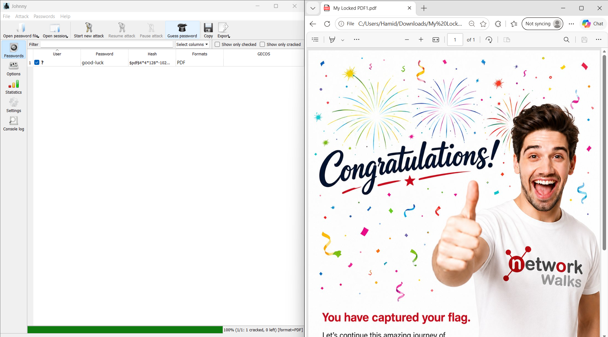

### Step 5 — Repeated the process on PDF2 and PDF3

Same workflow applied to the other two training PDFs, each cracked successfully and each containing a unique flag:

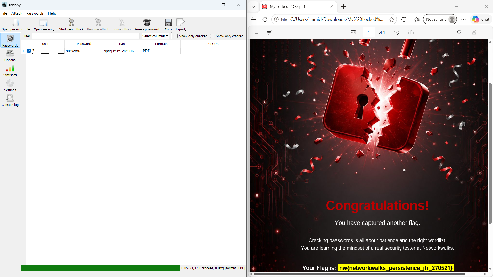
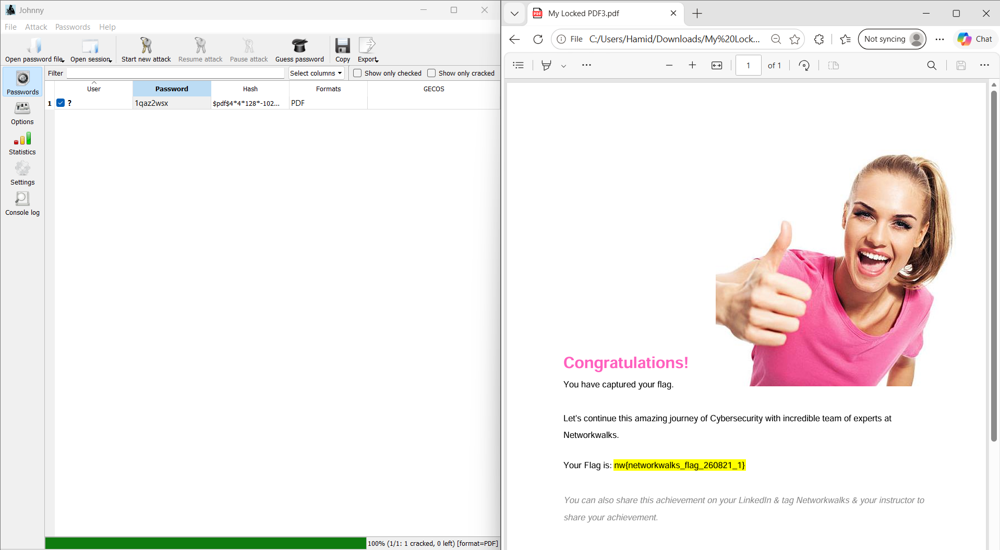

---

## 2️⃣ Password Cracking with Networkwalks' Own Tools

Networkwalks Academy provides two free browser-based tools that replicate the same JTR workflow without needing any local install: the **Hash Calculator** and the **Password Cracker** (dictionary attack lab).

### Step 1 — Extract the hash with the Hash Calculator

[networkwalks.com/hash-calculator](https://networkwalks.com/hash-calculator/) parses the PDF entirely client-side ("nothing is uploaded, the PDF is parsed locally") and extracts the same `$pdf$` hash format used by `pdf2john`.

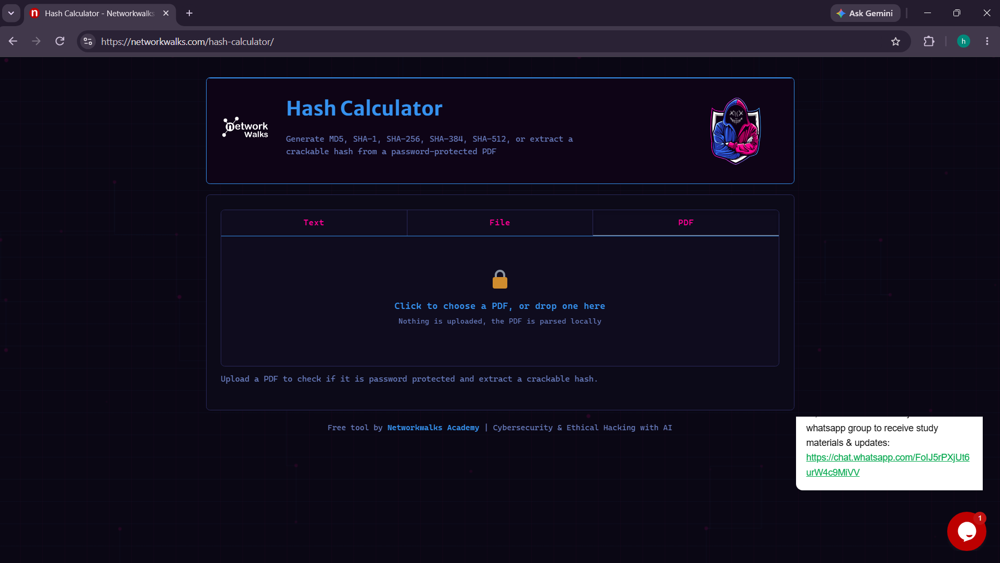
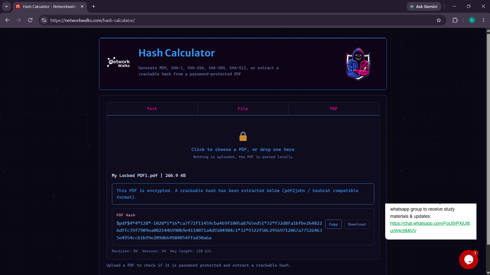

### Step 2 — Run the Password Cracker with the built-in wordlist

[networkwalks.com/password-cracker](https://networkwalks.com/password-cracker/) pastes the hash in and runs a dictionary attack. First attempt used the tool's built-in 100-password list — this **did not** contain the correct password.

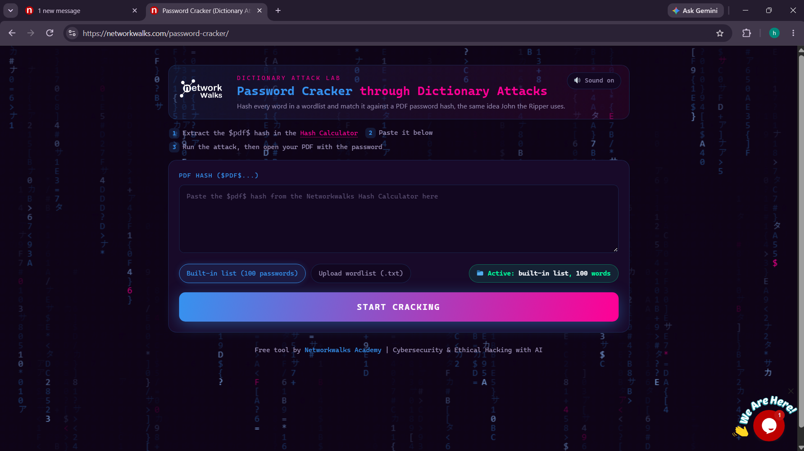
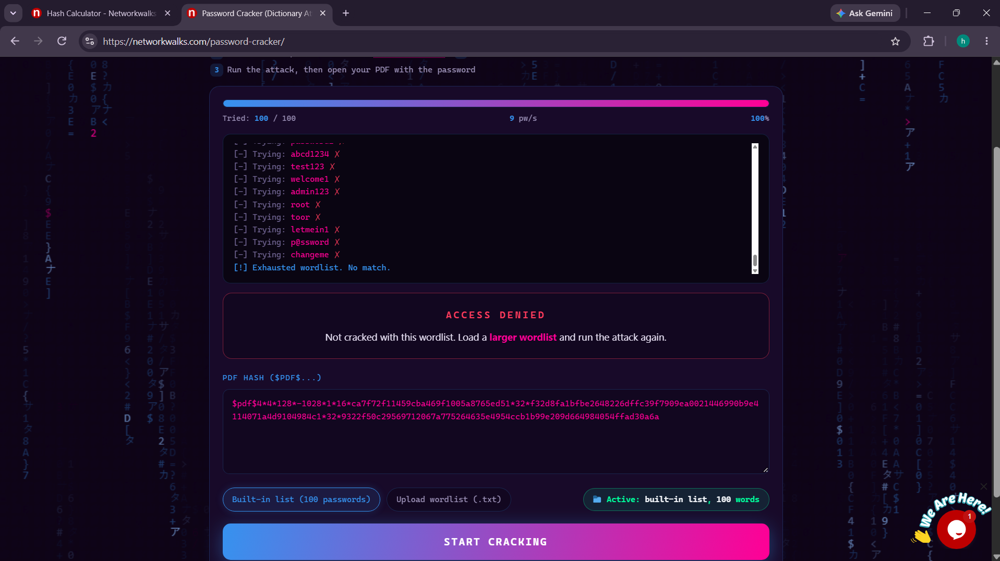

### Step 3 — Retry with a custom wordlist

Uploaded a small custom wordlist (4 entries, including `good-luck`) and re-ran the attack — matched instantly.

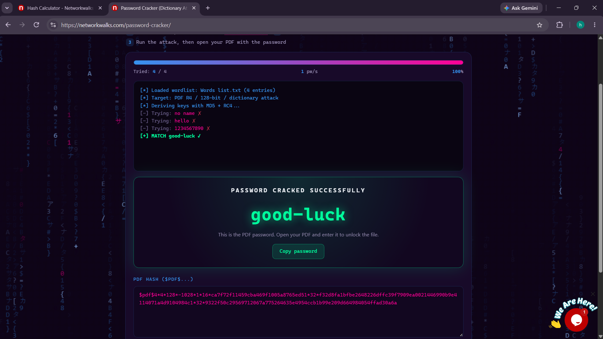

**Takeaway:** This step was a good practical reminder that dictionary attacks are only as good as the wordlist behind them — a generic top-100 list missed it, but a targeted 4-word list caught it immediately. Real-world wordlists (like `rockyou.txt`) succeed by sheer volume rather than cleverness.

---

## ✅ Summary

| Module | Tool | Result |
|---|---|---|
| PM1 — JTR password cracking | John the Ripper + Johnny GUI | ✅ All 3 PDFs cracked |
| PM2 — Networkwalks tools | Hash Calculator + Password Cracker | ✅ PDF1 cracked (custom wordlist) |

---

## 📁 Repo Structure

```
.
├── README.md
├── LICENSE
└── screenshots/
    ├── 01-johnny-jtr/
    └── 02-networkwalks-tools/
```

---

## 🚧 Next Steps

- [ ] Move to the next phase of the internship curriculum

---

## 📄 License

This documentation is shared under the [MIT License](LICENSE).

---

## ✍️ Author

**Muhammad Afaq Sajid**
Week 3 Internship Project — Network Walks Academy
